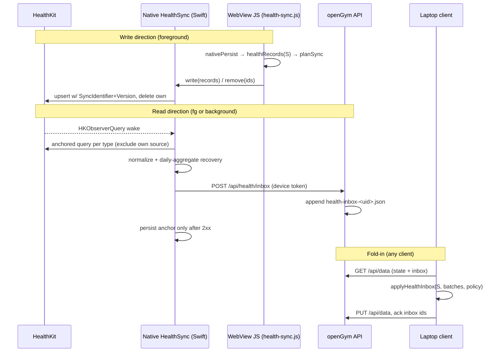
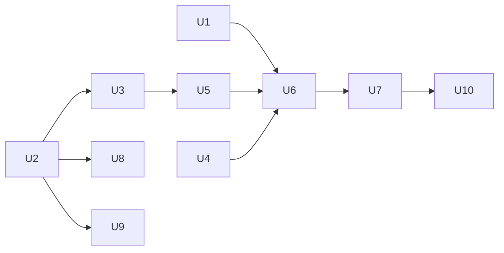

# feat: Two-way Apple Health (HealthKit) sync on iOS

**Target repo:** its-everdred/openGym (fork of DuarteSantos8/openGym)

## Overview

Add a hand-written Capacitor Swift plugin plus a native background sync engine to the existing iOS shell (`frontend/ios`). It will write openGym workouts, weigh-ins, active energy and body composition to Apple Health, and read weight, body composition, other apps' workouts (as read-only activities) and recovery signals (sleep, resting HR, HRV) back into openGym. Every behavior is a user setting, and the defaults come from the origin doc. Health-derived data reaches the user's server, and therefore the laptop and the AI coach, even when the iPhone app is closed.

---

## Problem Frame

Today iPhone users only have a one-time `export.xml` weight import (`frontend/src/lib/import-csv.js` `parseBodyweight`). Android has write-only Health Connect. Upstream plans HealthKit **export** only, for v1.4.8 (2027-03). This plan delivers full two-way sync on the fork. See origin: `docs/brainstorms/2026-10-11-apple-health-two-way-sync-requirements.md`.

---

## Requirements Trace

R1–R18 from the origin doc, grouped:
- Settings: R1 card iOS-only and off by default. R2/R3 per-category read and write toggles, all on. R4 permission asked per enabled category. R5 weight conflict policy, default most recent wins. R6 backfill, default all history. R7 background toggle, default on. R8 per-category server sync, default on.
- Write: R9 workouts, with type, notes and estimated energy. R10 edits replace and deletes remove, never duplicating.
- Read: R11 weight and composition merged under R5. R12 external workouts as read-only activities, excluded from progression, PRs and volume. R13 recovery trends plus coach context, never auto-changing plans. R14 no echo. R15 deletions in Health propagate.
- Trust: R16 status card. R17 failures visible and never blocking saves. R18 disable asks keep or remove.

**Origin actors:** A1 (iPhone user), A2 (other Health sources), A3 (openGym server)
**Origin flows:** F1 (turn on sync), F2 (background scale weigh-in), F3 (turn off sync)
**Origin acceptance examples:** AE1 (R5, R11), AE2 (R12, R14), AE3 (R8, R13), AE4 (R4, R16)

---

## Scope Boundaries

Carried from origin:
- Android Health Connect stays write-only.
- No HealthKit in the PWA or browser.
- External workouts are never editable openGym workouts and never count toward volume, PRs, progression or the recovery model.
- No readiness score or automatic deloads.
- No Apple Watch app.
- No public App Store release. Distribution is TestFlight for the user and a few testers.

### Deferred to Follow-Up Work

- Upstreaming to DuarteSantos8/openGym. That would be a separate PR series after this works on the fork. The upstream v1.4.8 roadmap overlaps (`ROADMAP.md`).
- Reading HRV RMSSD (an iOS 27 type, reported only in blogs) once Apple's own docs confirm it. v1 reads SDNN and labels it as such.

---

## Context & Research

### Relevant Code and Patterns

- **Platform-neutral record building to reuse:** `frontend/src/lib/health-connect.js`. It provides `healthRecords(S)`, `sessionRecord` (ids `opengym-w-<id>`, `CARDIO_TYPES` mapping, notes from `workoutText` capped at 1000 characters), `weightRecord` (`opengym-bw-<day>`, kg, 08:00 local for back-dated entries), `recordKey` cyrb53 fingerprints, and `planSync(records, written)`.
- **Orchestration to extend:** `frontend/src/lib/health-sync.js`. It covers device-local `opengym-health.json` (`{on, written, at, error}`, never in `S`), a single-flight run with a `running`/`again` re-run, the error kinds `permission|unavailable|failed`, `enableHealth`, `disableHealth({removeWritten})`, `onHealthChange`, and `initHealthSync` (on app active, plus 3 s after launch). It is hard-gated to Android in `plugin()`.
- **Write trigger:** `frontend/src/store/useStore.js`. `nativePersist` debounces 800 ms and then calls `syncHealth(get().S)`, near line 496. `initHealthSync` is wired near line 476.
- **Android plugin shape to mirror:** `frontend/android/app/src/main/java/ch/duartesantos/opengym/HealthConnectPlugin.java`, with methods `status`, `requestPermissions`, `write`, `remove` and `openSettings`.
- **iOS custom plugin precedent:** `frontend/ios/App/App/PrintPlugin.swift` plus `PrintPlugin.m` (`CAP_PLUGIN`), hand-added to `project.pbxproj`. CocoaPods, deployment target 15.5, `SceneDelegate.swift` present. There is no `.entitlements` file and no `PrivacyInfo.xcprivacy`. `Info.plist` has only camera and microphone strings.
- **Settings card:** `frontend/src/views/Settings.jsx`, where `HealthConnectCard` is gated on `MOBILE && android` (around line 787; card around lines 1436–1500). Test: `frontend/src/views/Settings.health.test.jsx`.
- **State model:** `S.bodyweight` is `[{d, w, t}]`, one entry per day, `w` in the profile unit. `S.measurements` is one check-in per day, with `bodyFat` as a percent (`frontend/src/lib/measurements.js`). `S.workouts` is `[{id, d, start, end, name, entries, _ts, _f}]`.
- **Merge:** `frontend/src/lib/sync-merge.js` `mergeStates`. Bodyweight and measurements use `mergeBodyweight`, a union by day where the later `t` wins. **Unknown top-level keys are taken wholesale from the newer copy**, so every new collection needs an explicit union rule. A new list also has to be added to `RESET_LISTS`, `DEL_LISTS`/`DEL_TIME` and `sinceReset`, to the server copy in `api/sync-stamps.js` (pinned by `frontend/src/lib/sync-stamps-parity.test.js`), and optionally to `frontend/src/lib/sync-changes.js` `LISTS`.
- **Server:** `api/server.js` routes object. `PUT /api/data` checks very little and enforces `baseRev` 409. `MAX_BODY` is 5 MB. Per-user state lives in `state-<uid>.json`, written via `atomicWrite`.
- **Readers of `S.workouts` that must not see externals:** `lib/recovery.js`, `lib/onerm.js`, `lib/history.js`, `lib/finish-workout.js`, `lib/structuralBalance.js`, `lib/exercise-history.js`, `lib/nudge.js`, the coach payload and `mcp/`. About 30 files in all read `.workouts`.
- **Display surfaces for externals:** `views/History.jsx`, `components/Heatmap.jsx` (used in `views/Stats.jsx`), and `calendarSheet` in `sheets.jsx` (used by Home and Stats).
- **AI coach:** `api/coach/core/payload.js` `build()` puts `p.bodyweight` around lines 538–553. Consent categories are in `api/coach/core/categories.js`, mirrored in `frontend/src/lib/coach-local.js` and `views/CoachSetup.jsx`, with parity in `frontend/src/lib/coach-parity.test.js`. Prompts are `api/coach/prompts/review.md` and `debrief.md`.
- **Existing importer conflict rule:** `frontend/src/lib/import-csv.js` `mergeImport`, where existing days win.
- **i18n:** `t('English literal')`. All 18 packs in `frontend/src/locales/` must define every new key, or `scripts/check-locales.mjs` fails CI.

### Institutional Learnings

- There is no `docs/solutions/` in the repo. CONTRIBUTING's rule applies: anything that reads data back into training state is a pure helper in `frontend/src/lib/` with a test next to it.

### External References

- WWDC20 "Synchronize health data with HealthKit" covers `HKMetadataKeySyncIdentifier` + `HKMetadataKeySyncVersion` upserts: https://developer.apple.com/videos/play/wwdc2020/10184/
- Background delivery needs the `com.apple.developer.healthkit.background-delivery` entitlement (iOS 15+): https://developer.apple.com/forums/thread/690974. Frequency is a maximum and only stepCount is documented as hourly-capped: https://developer.apple.com/forums/thread/790004
- A free personal team cannot sign the HealthKit entitlement: https://developer.apple.com/forums/thread/125980
- App Review Guideline 5.1.3: no ads or data mining, no false data, no health data in iCloud. https://developer.apple.com/app-store/review/guidelines/
- Community plugins were rejected. @perfood/capacitor-healthkit is unmaintained (Capacitor 4). @capgo/capacitor-health writes no workouts. Capawesome Health is paid, needs Capacitor 8 and has no deletes, anchors or background delivery.
- Prior art for conflicts: MacroFactor source priority (manual entry beats Health): https://help.macrofactorapp.com/en/articles/56-weight-or-nutrition-source-priority. Anchored sync pitfalls: https://github.com/microsoft/health-data-sync and the lunarlog anchor/deletion PRs.

---

## Key Technical Decisions

- **Custom Swift plugin, no npm dependency.** This follows the dependency-light rule, and no community plugin covers anchors, deletes, sync-identifier upserts and background delivery together.
- **Two engines, one set of rules.**
  - The *write* direction is driven from JS, mirroring Health Connect. JS builds records with the shared builder, and native upserts them by sync identifier.
  - The *read* direction is native. A singleton `HealthSync` is started in `AppDelegate.didFinishLaunching`, before the WebView, so background delivery works.
  - Native only collects and normalizes raw samples. **All merge rules live in pure JS** (`lib/health-import.js`), so they are testable and shared by every device.
- **Two delivery channels for reads, one fold-in function.**
  - **Device queue (always).** Native writes normalized batches to a device-local queue file, excluded from backup. JS drains it with the plugin's `pending()` and `ack(ids)` on app active, after `syncNow`, and during backfill. This is the only channel in local mode (no paired server, the mobile default per `frontend/src/lib/remote.js`) and for categories whose server sync is off.
  - **Server "health inbox" (paired phone, server sync on).** JS can't run in the background, and native code writing `state-<uid>.json` would fight `baseRev`. So in the background, native also POSTs the batch to an append-only endpoint, and the server stores it in `health-inbox-<uid>.json`. `GET /api/data` delivers un-acked batches, and **any client** folds them in. `GET /api/data/rev` also returns an inbox marker (newest batch time and count), so `checkRev` in `frontend/src/store/useStore.js` pulls when it changes. Without the marker, the laptop would never notice an inbox append.
  - Both channels feed the same pure `applyHealthInbox`, which is idempotent by HealthKit UUID and day, so a batch arriving by both channels applies once.
  - **Acks happen only after durability.** Inbox ids are acked only after a `PUT /api/data` carrying the folded rows returns 2xx. Pending acks are kept device-local and retried after the next successful push. Device-queue items are acked after the local persist.
  - This meets "the laptop shows the scale weigh-in without opening the phone" without any server-side merge logic.
- **Scoped device token for native uploads.**
  - When sync is turned on in a paired app, the app's existing Bearer pairing session (`api/server.js` `sessionOf`, `frontend/src/lib/remote.js`) mints a per-device token that only allows inbox writes. It reuses the hashing and device-label pattern in `api/device-link.js` rather than inventing a parallel one.
  - The token is 256-bit random, stored hashed and bound to the uid and device. It expires after 90 days and rotates on each foreground sync.
  - It is revoked on sync disable, device unpair, passkey or account deletion, and from the Health card on any signed-in client.
  - It is stored in the Keychain with `kSecAttrAccessibleAfterFirstUnlockThisDeviceOnly`, so it works while the phone is locked but never migrates via backup.
  - Native only uploads over HTTPS to the configured server origin, pinned at `configure` time. It also attaches the Cloudflare Access client headers when the app uses them (`frontend/src/lib/cf-access.js`).
  - The pairing session itself is never handed to native code.
- **New collections, not `S.workouts`.**
  - `S.healthActivities` holds read-only external workouts, keyed by HealthKit UUID.
  - `S.recovery` holds per-day aggregates: sleep minutes from one chosen source, resting HR, HRV SDNN, and the source name.
  - Every reader of `S.workouts` stays untouched, which satisfies R12 by construction.
  - Weight and body composition from Health go into the existing `S.bodyweight` and `S.measurements`, with `src = {uuid, name}` (the HealthKit sample UUID and source name). They can share the existing lists because merge-by-day already fits.
  - These weights *do* feed bodyweight-dependent analytics (`lib/structuralBalance.js` `bodyweightKgOf`, Stats muscle balance). That is intended: a scale reading is the user's real weight.
  - When a Health value replaces an openGym entry, the replaced openGym value is kept on the entry as `prev`, so a later Health deletion restores it instead of emptying the day.
- **Daily aggregates for recovery, recomputed per touched day.** Raw HR, HRV and sleep samples over years would blow `MAX_BODY` (5 MB) and bloat state. One row per day per signal is enough for the trends and the coach.
  - The anchored query is used only to find *which local days changed*, including days touched by `deletedObjects`, through a native UUID→day index.
  - Native then re-queries each touched day in full and uploads a complete row (or a delete for that day).
  - Aggregating only the delta would produce partial means and sleep fragments that overwrite whole nights.
- **Echo prevention in both directions.**
  - *Reads* exclude `HKSource.default()` and any sync identifier starting with `opengym-` (R14).
  - *Writes* skip every `S.bodyweight` and `S.measurements` entry that carries a Health `src`. Otherwise every scale reading would be copied back into Health as a duplicate `opengym-bw-<day>`.
  - When a Health value replaces a day openGym had already written, the stale `opengym-bw-<day>` record is removed from Health.
  - Writes reuse the existing ids (`opengym-w-<id>`, `opengym-bw-<day>`), with sync version = the record's `_ts`/`t` in ms, or 1 when missing (R10).
- **Conflict policy is applied in JS at fold-in time** (R5). The three options:
  - *most recent wins* compares the sample time against the openGym entry's `t`. That is the existing `mergeBodyweight` rule, fed with the HealthKit sample time.
  - *openGym entry wins* only fills empty days.
  - *keep all readings* stores the extra readings on the day entry as `readings[]`, and the chart uses the latest. This avoids changing the one-entry-per-day contract.
- **Day bucketing** uses the sample's own timezone (`HKMetadataKeyTimeZone`) when present, otherwise the device timezone.
- **Settings scope.**
  - On/off, per-category read/write, background and backfill are **device-local** in `opengym-health.json`, as Health Connect does.
  - The conflict policy (R5) and per-category server sync (R8) **sync in `S.settings`**, because every client applies them at fold-in.
  - When a category's server sync is off, native never uploads it. JS receives it only through the device queue and folds it into a local-only overlay, `opengym-health-local.json`. That file is device-local, excluded from backup and never pushed, and it is deleted on disable when the user chooses removal (R18).
  - Anchors, the device queue and the overlay all live under a non-backed-up directory (`isExcludedFromBackup`), so health data never reaches iCloud (Guideline 5.1.3).
- **Active energy estimate:** MET × body-weight kg × hours. Strength uses MET 3.5 (light) to 5 (vigorous), picked by the session's effort column when present. Body weight is the latest weigh-in. It is written as an estimate, and the card says so (Guideline 5.1.3(ii)).
  - **It is skipped when another source has already recorded the interval.** If HealthKit holds an overlapping workout or active-energy sample from another source (for example an Apple Watch strength session), the estimate is not written, so the Move ring isn't double-counted.
- **Ingest is validated in two places.** The server validates each inbox batch at ingest, and `applyHealthInbox` re-applies the same bounds:
  - allowed keys and types
  - numeric ranges: kg 20–400, body fat 2–75 %, bpm 25–220, HRV 1–300 ms, sleep 0–1440 min
  - date bounds
  - UUID format
  - string length caps (source names ≤ 80 characters)
  - items per batch ≤ 2000, and a route body limit
  
  Deletions apply only to UUIDs that were previously imported, so a leaked token can't erase rows.
- **Read denial is invisible in HealthKit.** The card shows "No data found, check Settings › Health › Data Access" instead of "denied" for reads. Only write denial can be detected. This **refines AE4**: the card cannot claim "HRV denied", only "no HRV data".

---

## Open Questions

### Resolved During Planning

- Plugin choice: custom Swift (see Key Technical Decisions).
- Background reach: native upload to a server inbox, using a scoped device token.
- Where externals live: new collections, so no analytics changes are needed.
- Free Apple account: not viable. The paid Developer Program is a hard prerequisite.
- Existing `export.xml` import rule: unchanged (existing days win), and documented as different from live sync.

### Deferred to Implementation

- Exact anchored-query page size for backfill (500–2000), tuned on a real device with years of data.
- What `t` a Health-derived entry carries (the sample time, used by the `recent` policy) versus how `mergeBodyweight` treats `t` as edit time across devices. One option is to add `hkT` for the sample time and keep `t` as the edit time. Settle this with a two-device test in U2 and U3.
- Whether to back-date years of openGym workouts into Health when the Watch already holds the same sessions. The default is to write them, skipping ones that overlap an existing workout from another source.
- Inbox encryption at rest, and App Attest binding for the device token. v1 relies on the existing `data/` trust model.
- Whether `HKWorkoutBuilder` with `.local()` device metadata is accepted for back-dated backfill workouts, or needs a non-local device.
- The inbox size cap per user. Retention is decided: 30 days.
- Sleep source pick rule tie-breaks when Watch and a third-party ring overlap. The starting rule is most asleep time, with stage detail as the tie-breaker.

---

## High-Level Technical Design

> *This illustrates the intended approach and is directional guidance for review, not implementation specification. The implementing agent should treat it as context, not code to reproduce.*

---

## Implementation Units

- [ ] U1. **Extract a platform-neutral health record builder**

**Goal:** Move the record building and planning out of `health-connect.js` so the iOS writer reuses it. Android behavior must not change.

**Requirements:** R9, R10

**Dependencies:** None

**Files:**
- Create: `frontend/src/lib/health-records.js`
- Modify: `frontend/src/lib/health-connect.js` (keep the Android type mapping and re-export)
- Test: `frontend/src/lib/health-records.test.js`, `frontend/src/lib/health-connect.test.js` (must pass unchanged)

**Approach:**
- Neutral pieces: session and weight records, fingerprints, `planSync`, `writtenIds`.
- Platform pieces: an activity-type mapper per platform. The HealthKit mapper uses `traditionalStrengthTraining` for any non-cardio exercise, plus running, cycling, walking, elliptical and stairClimbing for catalogue cardio machines, and otherwise `other`.
- Add body-composition records (body fat %, lean mass if present) and active-energy estimate records, so both platforms can use them later. Android doesn't emit them in this plan.
- Add the active-energy estimate as a pure function.

**Patterns to follow:** the `frontend/src/lib/health-connect.js` structure and test style.

**Test scenarios:**
- Happy path: a strength workout with real start and end → session record with id `opengym-w-<id>`, HealthKit type `traditionalStrengthTraining`, and notes ≤ 1000 characters.
- Happy path: a cardio-only treadmill workout → HealthKit `running`.
- Edge case: a workout missing `end` → no record (never invented times).
- Edge case: a weigh-in in lb → kg value. A back-dated weigh-in → 08:00 local on its own day.
- Happy path: energy estimate for 60 min at 80 kg with MET 3.5 → 280 kcal, flagged as an estimate.
- Edge case: energy estimate with no weigh-in → no energy record.
- Edge case (echo): an `S.bodyweight` entry with a Health `src` → no weight record. The same goes for a measurement with a Health `src`.
- Edge case: a day whose openGym weigh-in was replaced by a Health value → `planSync` lists `opengym-bw-<day>` under `remove`.
- Integration: the existing `health-connect.test.js` passes unmodified.

**Verification:** Android output is byte-identical for the existing fixtures, and the iOS mapping is covered.

---

- [ ] U2. **Data model for Health-derived data, and the merge rules**

**Goal:** Add `S.healthActivities` and `S.recovery`, plus a `src` (and optional `readings[]`) field on bodyweight and measurement entries. Make sync, reset and delete handle them.

**Requirements:** R8, R11, R12, R13, R15

**Dependencies:** None

**Files:**
- Modify: `frontend/src/store/useStore.js` (defaults), `frontend/src/lib/sync-merge.js`, `frontend/src/lib/sync-changes.js`, `api/sync-stamps.js`
- Test: `frontend/src/lib/sync-merge.test.js` (or the existing equivalent), `frontend/src/lib/sync-stamps-parity.test.js`

**Approach:**
- `healthActivities` is a union by HealthKit UUID, where the newer `_ts` wins and tombstones are honored. `recovery` is a union by day, where the later `t` wins.
- Add both lists to `RESET_LISTS`, `DEL_LISTS`/`DEL_TIME` and `sinceReset`, and keep the server copy in parity.
- Add `S.settings.health = {conflict: 'recent'|'opengym'|'all', serverSync: {weight, composition, activities, recovery}}` with the origin defaults.

**Patterns to follow:** the `mergeBodyweight` and tombstone handling in `sync-merge.js`.

**Test scenarios:**
- Integration: device A adds an external activity and device B adds a different one → the merge keeps both. Without the new rule, the newer copy would wipe the older one, which is the regression this test pins.
- Edge case: an activity deleted (tombstoned) on one device and untouched on the other → it stays deleted.
- Happy path: recovery for the same day from two devices → the later `t` wins.
- Integration: the server/client sync-stamps parity test covers the new lists.
- Edge case: a reset wipes both new lists.

**Verification:** the existing merge tests pass, and the new lists survive a two-device merge.

---

- [ ] U3. **Pure fold-in logic for Health data (`applyHealthInbox`)**

**Goal:** One pure function turns normalized HealthKit batches into `S` changes, applying the conflict policy, echo filtering, deletions, day bucketing and the server-sync overlay.

**Requirements:** R5, R11, R12, R13, R14, R15; AE1, AE2, AE3

**Dependencies:** U2

**Files:**
- Create: `frontend/src/lib/health-import.js`
- Test: `frontend/src/lib/health-import.test.js`

**Approach:**
- The input batch is `{weights[], composition[], activities[], recovery[], deleted[]}`. Each sample carries a HealthKit UUID, start and end, a timezone offset, a source name, and the sync identifier if one exists.
- Drop anything whose sync identifier starts with `opengym-`.
- Map weights into the profile unit, rounding only at display time and keeping kg internally to avoid round-trip drift.
- Apply the policy from `S.settings.health.conflict`.
- Deletions remove `healthActivities` by UUID. A `bodyweight`/`measurements` entry whose `src.uuid` matches is reverted to its `prev` openGym value when one exists, and removed otherwise. Recovery deletes arrive as whole-day rows from native.
- Out-of-range or malformed items are dropped using the shared bounds (see Key Technical Decisions).
- Return `{S, localOnly}`. Categories with `serverSync` off go into `localOnly`, never into `S`.

**Execution note:** Implement test-first. This is training-state read-back, as required by CONTRIBUTING.

**Test scenarios:**
- Covers AE1. Policy `recent`: openGym 80.5 kg at 07:00, Health 80.2 kg at 07:30 → the day becomes 80.2 kg with `src` set.
- Covers AE1. Policy `opengym`: same input → stays 80.5 kg. An empty day → filled from Health.
- Policy `all`: same input → the day holds the latest value, plus `readings[]` with both.
- Covers AE2. A batch with an Apple Watch run and a sample with sync id `opengym-w-123` → one activity added, the openGym echo ignored.
- Covers AE3. `serverSync.recovery = false` → recovery rows appear in `localOnly`, and `S.recovery` is unchanged.
- Edge case: a sample at 23:30 in UTC−7 → bucketed on the local day, not the UTC day.
- Edge case: a 180.0 lb profile, round-tripping a weight that came from openGym → no new weigh-in (echo plus unit drift).
- Error path: a malformed sample (missing dates) → skipped, the rest of the batch still applies.
- Happy path: a deletion of a previously imported activity UUID → the activity is removed (R15).
- Edge case: the same batch applied twice → no change the second time (idempotent).
- Happy path: policy `recent` replaces 80.5 kg with Health's 80.2 kg, then the Health sample is deleted → the day returns to 80.5 kg (from `prev`).
- Error path: a weight of 4000 kg, a source name of 5 KB, or a deletion of a UUID never imported → each is dropped, and the other items apply.
- Edge case: `all` policy, the same reading arriving by both the device queue and the inbox → `readings[]` holds it once (deduped by UUID).

**Verification:** every AE has a passing test, and the function has no I/O.

---

- [ ] U4. **Native iOS: HealthKit plugin and background sync engine**

**Goal:** A Swift `HealthKitPlugin` (the JS bridge) and a `HealthSync` singleton. Together they handle authorization, upserts and deletes of openGym's own records, anchored reads, background delivery and uploads to the server inbox.

**Requirements:** R2, R3, R4, R7, R9, R10, R14, R15, R17; F1, F2

**Dependencies:** None (the native code can be built alongside U1–U3; integration happens in U6)

**Files:**
- Create: `frontend/ios/App/App/HealthKitPlugin.swift`, `frontend/ios/App/App/HealthKitPlugin.m`, `frontend/ios/App/App/HealthSync.swift`, `frontend/ios/App/App/App.entitlements`, `frontend/ios/App/App/PrivacyInfo.xcprivacy`
- Modify: `frontend/ios/App/App/AppDelegate.swift`, `frontend/ios/App/App/Info.plist`, `frontend/ios/App/App.xcodeproj/project.pbxproj`
- Test: `frontend/ios/App/AppTests/HealthSyncTests.swift` (new XCTest target for the pure Swift normalization). Device checks are in the Verification list below.

**Approach:**
- Plugin methods, mirroring Android: `status`, `requestPermissions(categories)`, `write(records)`, `remove(ids)`, `syncNow()`, `pending()`, `ack(ids)`, `configure({token, server, cfAccess, categories, serverSync, background})`, `openSettings`.
- Before writing estimated energy, check for an overlapping workout or energy sample from another source, and skip the estimate if one exists.
- Writes:
  - Workouts go through `HKWorkoutBuilder`, attaching the active-energy sample. The `HKWorkout` initializers are deprecated.
  - Every write carries `HKMetadataKeySyncIdentifier` (the openGym id) and `HKMetadataKeySyncVersion` (ms timestamp).
  - Removes use a sync-identifier metadata predicate, and only affect openGym's own source.
- Reads:
  - Use one `HKAnchoredObjectQuery` per enabled type, excluding `HKSource.default()`. Anchors are archived per type in the app container.
  - Backfill pages through history with a limit.
  - For recovery types, the anchored delta only marks touched local days, using a UUID→day index for deletions. Each touched day is then re-queried in full and aggregated. Sleep: group by night and source, then pick one source (most asleep time). Resting HR: the daily value. HRV: the daily mean of SDNN, labeled as SDNN.
- Delivery:
  - Each normalized batch is first appended to the device queue file (non-backed-up). The anchor is persisted once the batch is in the queue.
  - If the app is paired and the category's server sync is on, native also POSTs the batch to `/api/health/inbox` with the device token, inside `beginBackgroundTask`. Failed uploads stay marked in the queue and are retried.
  - On a 413 (inbox cap), uploads pause until JS drains the queue and the server inbox is acked.
  - A locked-database error leads to a retry on the next wake or on foreground.
- Background:
  - `HKObserverQuery` objects are registered in `didFinishLaunching` before it returns, and re-created on every launch.
  - `enableBackgroundDelivery(.immediate)` is called for weight, composition and workouts, and `.hourly` for recovery types.
  - The completion handler is always called.
- Plist and entitlements:
  - `NSHealthShareUsageDescription` and `NSHealthUpdateUsageDescription`, naming "your openGym server".
  - The `com.apple.developer.healthkit` and `healthkit.background-delivery` entitlements, set through `CODE_SIGN_ENTITLEMENTS`.
- Keychain: the token is stored with after-first-unlock accessibility.
- The plugin is a no-op if HealthKit is unavailable (iPad without Health → `unavailable`).

**Patterns to follow:** `frontend/ios/App/App/PrintPlugin.swift` and `.m` registration, and the pbxproj hand edits. Method names and error kinds follow `HealthConnectPlugin.java`.

**Test scenarios:**
- Happy path (XCTest): normalizing a sleep set with an overlapping Watch and ring → one night with the Watch total, and no summing across sources.
- Happy path (XCTest): HRV samples across a day → one mean value labeled `sdnn`.
- Edge case (XCTest): a sample with `HKMetadataKeyTimeZone` → the local day uses that zone.
- Edge case (XCTest): a sample with sync id `opengym-…` → excluded.
- Error path (XCTest): the upload returns 500 → the batch stays queued and marked un-uploaded, and the next run retries it.
- Edge case (XCTest): one day's HRV samples arrive in two separate deltas → the uploaded day row equals a single-batch computation.
- Edge case (XCTest): a deleted sleep sample → the affected night is recomputed and re-sent.
- Note: CI (`.github/workflows/test.yml`) is Node/Linux only, so XCTests run locally in Xcode. Keep the normalization logic small and pure so the JS tests carry most of the coverage.

**Verification (on device, through TestFlight or a paid-team Xcode build):**
- Writing the same workout twice leaves one Health entry. Editing it updates it in place, and deleting it removes it.
- A weight added in Health while the app is backgrounded reaches the server inbox within minutes.
- Force-quit is documented as best effort; sync resumes on the next open.

---

- [ ] U5. **Server health inbox and scoped device token**

**Goal:** Native code can upload Health batches without a session cookie, and any client can fetch and ack them.

**Requirements:** R8, F2, success criterion "the laptop shows a scale weigh-in without opening the phone"

**Dependencies:** U3 (batch shape)

**Files:**
- Modify: `api/server.js` (routes, plus inbox delivery in `GET /api/data`), `api/openapi.yaml`, `docs/API.md` (if present)
- Create: `api/health-inbox.js` (pure helpers for append, ack, caps and token checks)
- Test: `api/health-inbox.test.js`, and the server route tests in the existing `api` test suite

**Approach:**
- Routes:
  - `POST /api/health/token` (session-auth) mints a per-device token. The server stores only its hash in `db.json`, along with a device label.
  - `DELETE /api/health/token/:id` revokes a token.
  - `POST /api/health/inbox` (token-auth) appends a batch to `health-inbox-<uid>.json` through `atomicWrite`, with a per-user size cap.
  - `POST /api/health/inbox/ack` (session-auth) drops the acked batch ids.
  - `DELETE /api/health/inbox` (session-auth) purges the inbox.
  - `GET /api/data` includes the un-acked batches. `GET /api/data/rev` includes an inbox marker (newest batch time and count).
- Ingest validates every batch with the shared bounds before appending, and rejects the whole batch on a schema violation.
- The token only grants inbox append. It can't read state, it's rate-limited per token, and it's audit-logged (`data/audit.log`). Audit entries record counts and ids only, never health values.
- Un-acked batches expire after 30 days. The inbox is purged on account deletion. All of the user's tokens are revoked on account or passkey deletion.
- Disabling sync revokes the token. If the user picks removal, it also purges the inbox and removes Health-sourced rows through a normal state push (R18).

**Patterns to follow:** the `routes['METHOD /path']` dispatch, `atomicWrite`, the invite-code hashing and audit-log patterns in `api/server.js`.

**Test scenarios:**
- Happy path: mint a token, POST a batch, then GET `/api/data` → the batch is present. After ack, a second GET → the batch is gone.
- Error path: an inbox POST with a revoked or unknown token → 401, and nothing is written.
- Error path: a token used against `GET /api/data` → 401 (the scope is enforced).
- Edge case: a batch over the per-user cap → 413, and earlier batches are intact.
- Edge case: acking an unknown id → no-op, 200.
- Integration: concurrent inbox POST and `PUT /api/data` → both succeed. The inbox file is independent of `baseRev`.
- Happy path: an inbox POST with no state change → the inbox marker in `GET /api/data/rev` changes.
- Error path: a batch with a 4000 kg weight or an unknown key → 400, and nothing is appended.
- Happy path: a batch older than 30 days and un-acked → pruned on the next write.
- Happy path: `DELETE /api/health/inbox` → the inbox is empty. Account deletion → the inbox file and tokens are gone.

**Verification:** the openapi spec documents all four routes, and the API tests pass.

---

- [ ] U6. **iOS orchestration in `health-sync.js`, plus fold-in on every client**

**Goal:** Make `health-sync.js` platform-aware (Android unchanged). On iOS, run the write direction, configure native with the token and categories, show backfill progress, and fold inbox batches into `S` on every client, laptop included.

**Requirements:** R1, R4, R6, R7, R10, R16, R17; F1, F2

**Dependencies:** U1, U3, U4, U5

**Files:**
- Modify: `frontend/src/lib/health-sync.js`, `frontend/src/lib/mobile.js` (add `isIOS()`), `frontend/src/lib/api.js` (token, inbox and ack calls), `frontend/src/store/useStore.js` (fold the inbox in on load and pull)
- Test: `frontend/src/lib/health-sync.test.js` (add iOS cases with `getPlatform: 'ios'`), `frontend/src/store/useStore.health-inbox.test.jsx`

**Approach:**
- `plugin()` registers `HealthKit` on iOS and `HealthConnect` on Android.
- `opengym-health.json` gains `{platform, categories:{read:{…}, write:{…}}, background, backfill, tokenId, progress}`, kept device-local.
- `enableHealth`:
  1. Request permission for the enabled categories.
  2. Mint the token and `configure` native.
  3. Do a full write (backfill per the R6 setting).
  4. Start the native read backfill.
- Fold-in:
  - On the phone, drain `pending()` on app active, after `syncNow` and during backfill. Fold the results with `applyHealthInbox`, persist (the local-only categories go to the overlay file), then `ack(ids)` natively.
  - On any client: after `GET /api/data`, fold the inbox batches. Ack them **only after** the `PUT /api/data` carrying the folded rows returns 2xx. Pending ack ids are kept device-local and retried after the next successful push.
  - `checkRev` in `frontend/src/store/useStore.js` also pulls when the inbox marker changes.
  - Local mode (no paired server): only the device queue is used. No token is minted and nothing is uploaded.
- Errors never block saves. They only set `error` on the device-local state (R17).

**Patterns to follow:** the existing single-flight `running`/`again` loop, error kinds, `onHealthChange` listeners, and the test mocks in `health-sync.test.js`.

**Test scenarios:**
- Happy path (iOS): enable → permissions requested for only the enabled categories (covers R4), token minted, native configured, full write issued.
- Happy path: a save while a sync is running → exactly one extra pass.
- Error path: the native write rejects → `error: 'failed'` is stored and the save still completes (R17).
- Integration (laptop, non-mobile): `GET /api/data` returns an inbox batch with a weight → `S.bodyweight` updated, the push sent, the ack sent (covers F2).
- Edge case: the same inbox batch delivered twice before the ack lands → applied once (idempotent).
- Integration: Android path unchanged. The existing Android tests pass as-is.
- Error path: the fold-in push fails with 409 or offline → no inbox ack is sent, the batch is redelivered, and it applies once.
- Integration: an inbox marker change with no state rev change → `checkRev` triggers a pull.
- Happy path (local mode): `pending()` returns a weight → it is folded, no token is minted, and no upload is attempted.
- Covers AE3: recovery server sync off → recovery reaches the overlay through `pending()`, and `S.recovery` and the pushed state contain none of it.

**Verification:** both platforms' tests pass, and the laptop folds in an inbox weight in an integration test.

---

- [ ] U7. **Apple Health settings card**

**Goal:** A settings card that exposes every behavior with the origin defaults, plus status and the disable flow.

**Requirements:** R1–R8, R16, R18; F1, F3; AE4 (refined)

**Dependencies:** U6

**Files:**
- Modify: `frontend/src/views/Settings.jsx` (new `AppleHealthCard`, gated on `MOBILE && ios`), all 18 files in `frontend/src/locales/`
- Test: `frontend/src/views/Settings.applehealth.test.jsx`

**Approach:**
- Sections:
  - an on/off toggle
  - "Read from Health" toggles: weight, body composition, workouts from other apps, recovery
  - "Write to Health" toggles: workouts, weight, active energy (marked "estimate"), body composition
  - weight conflict: most recent, openGym entry, keep all
  - "Send to my server" per read category
  - backfill: all, 90 days, none (shown before the first enable)
  - background sync
  - status: last sync, backfill progress, per-category state
- Read categories with no data show "No data found, check Settings › Health › Data Access & Devices › openGym", because read denial is undetectable.
- Disabling asks "Keep what openGym wrote to Health / Remove it", and separately "Keep Health data on your server / Delete it" (R18).
- The consent copy names the server host.

**Patterns to follow:** `HealthConnectCard` in `frontend/src/views/Settings.jsx` and `frontend/src/views/Settings.health.test.jsx`.

**Test scenarios:**
- Happy path: the card renders only on iOS mobile, and is hidden on Android and the web.
- Happy path: the defaults shown match the origin (everything on, most recent, all history, background on, server sync on).
- Covers AE4 (refined): HRV read enabled with no HRV data → "No data found" with Settings guidance, and weight shows a recent sync time.
- Happy path: the off flow calls `disableHealth` with the chosen keep/remove flags for both questions.
- Integration: changing the conflict policy writes `S.settings.health.conflict` (synced). A category toggle writes the device-local file, not `S`.

**Verification:** `scripts/check-locales.mjs` passes, and the card tests pass.

---

- [ ] U8. **Show external activities and recovery**

**Goal:** Read-only external activities appear in History, the calendar sheet and the heatmap. Recovery trends appear in Stats. Nothing in the training analytics changes.

**Requirements:** R12, R13; AE2

**Dependencies:** U2

**Files:**
- Modify: `frontend/src/views/History.jsx`, `frontend/src/sheets.jsx` (`calendarSheet`, row rendering), `frontend/src/components/Heatmap.jsx`, `frontend/src/views/Stats.jsx`, the locales
- Create: `frontend/src/lib/health-display.js` (a pure merge of workouts and activities for display)
- Test: `frontend/src/lib/health-display.test.js`, `frontend/src/views/History.health.test.jsx`

**Approach:**
- Display-only union: rows look like "Run · 32 min · via Apple Watch", with no edit affordance and a different badge.
- The heatmap counts activity days with a separate shade, or the same shade (decided at implementation time and noted in the PR).
- Stats gets a recovery card with 30- and 90-day sleep, resting HR and HRV (SDNN) trends. It is hidden when there is no data.

**Test scenarios:**
- Happy path: one workout and one external run on the same day → History shows both, and the run has no edit menu.
- Covers AE2: an external run never shows up in 1RM, PRs, the volume muscle map or `recovery.js` results. Assert that those functions receive only `S.workouts`.
- Edge case: no recovery data → the card is not rendered.

**Verification:** analytics tests are unchanged, and the display tests pass.

---

- [ ] U9. **AI coach recovery context**

**Goal:** When the coach is on and the user consents, the coach payload includes the daily recovery series. Plans are never changed automatically.

**Requirements:** R13; AE3

**Dependencies:** U2

**Files:**
- Modify: `api/coach/core/categories.js`, `api/coach/core/payload.js`, `api/coach/prompts/review.md`, `api/coach/prompts/debrief.md`, `frontend/src/lib/coach-local.js`, `frontend/src/views/CoachSetup.jsx`, the locales
- Test: `api/coach/core/payload.test.js` (or the existing equivalent), `frontend/src/lib/coach-parity.test.js`

**Approach:**
- Add a new consent category, `recovery`, **off by default**. It needs an explicit opt-in in `CoachSetup.jsx` that names the configured LLM provider, because sleep, HR and HRV are sensitive health data. Health source names are stripped from the payload.
- Add `p.recovery = {series}` next to `p.bodyweight`, using the same window. HRV is labeled SDNN.
- The prompts say this is context only, and that every change still goes through the existing approval flow.

**Test scenarios:**
- Happy path: recovery consent on with data → the payload contains `recovery.series`.
- Happy path: Health recovery read on, but coach recovery consent never granted → the payload has no recovery.
- Covers AE3: data that exists only in the phone's local overlay (server sync off) → the server-side payload has no recovery.
- Integration: the coach parity test passes with the new category.

**Verification:** the coach tests and parity tests pass.

---

- [ ] U10. **Distribution and docs: TestFlight, privacy, MOBILE.md**

**Goal:** The user and a few testers can install through TestFlight, and the docs explain the feature and its limits.

**Requirements:** Origin dependency (paid program, TestFlight), success criteria

**Dependencies:** U7

**Files:**
- Modify: `docs/MOBILE.md` (an Apple Health section mirroring the Health Connect one, plus TestFlight distribution), `docs/DATA_IMPORTS.md` (note that `export.xml` import keeps existing days, unlike live sync), `docs/FAQ.md`, `README.md` features list, `CHANGELOG.md`
- Create: `docs/PRIVACY_HEALTH.md` (the privacy policy text required for TestFlight and App Store Connect)

**Approach:**
- Prerequisites:
  - a paid Apple Developer Program account
  - an App ID with the HealthKit capability (Clinical Records off) and background delivery
  - a fork-specific bundle id, so the build doesn't collide with upstream's `ch.duartesantos.opengym`
- Builds come from Xcode Archive on a Mac, uploaded to App Store Connect. Internal testers need no review. External testers need Beta App Review once.
- Privacy label: Health & Fitness, linked to the user, used for app functionality, no tracking.
- Docs state the limits clearly: force-quit pauses background sync, read denial shows as "no data", the energy figure is an estimate, and HRV is SDNN.

**Test expectation:** none (docs and release configuration).

**Verification:** a TestFlight build installs on the user's iPhone and passes the device checks in U4.

---

## System-Wide Impact

- **Interaction graph:** `nativePersist` → `syncHealth` (write direction). `GET /api/data` → `applyHealthInbox` → normal push (read direction). AppDelegate launches → `HealthSync.start()` before the WebView.
- **Error propagation:** native errors go to plugin rejects, then to the device-local `error` and the card. They never throw into store saves. Server inbox errors are handled by native retries, and anchors are kept until a 2xx.
- **State lifecycle risks:** an anchor advanced before the upload would lose data, so it's only saved after a 2xx. An anchor lost on reinstall triggers a full re-read, which is idempotent because of UUID keys. An inbox batch applied twice is a no-op.
- **API surface parity:** `mcp/` reads the state file. External activities and recovery are new keys it ignores, which is acceptable. A follow-up could expose them.
- **Integration coverage:** two-device merge of new lists (U2), laptop fold-in (U6), and device background delivery (U4 verification).
- **Unchanged invariants:**
  - The Android Health Connect output stays byte-identical.
  - `S.workouts` and every analytic reading it are untouched.
  - The one-weigh-in-per-day shape is kept; `readings[]` is optional.
  - The `export.xml` importer rule is unchanged.
  - `PUT /api/data` validation and `baseRev` semantics are unchanged.

---

## Risks & Dependencies

| Risk | Mitigation |
|------|------------|
| Paid Apple Developer account and a Mac are required. The user's Mac access is unverified. | U10 lists it as a hard prerequisite. U1–U3 and U5–U9 can be built and tested without either. |
| Background delivery is throttled, and force-quit stops it | Also sync on foreground and at launch. Document it as best effort. |
| The device token leaks | Inbox-append scope only, hashed at rest, revocable, rate-limited and audit-logged. |
| State bloat from years of samples | Daily aggregates for recovery, a per-user inbox cap, paged backfill. |
| Duplicate workouts when the Watch also records the session | The read side shows Watch sessions as external activities. A follow-up could detect overlap with an openGym session and hide the duplicate. |
| The fork drifts from upstream, especially the v1.4.8 iOS work | Keep changes in new files where possible, and rebase often. |
| `sync-merge.js` takes unknown keys wholesale | U2 adds explicit rules plus a two-device regression test. |

---

## Documentation / Operational Notes

- New server data file: `health-inbox-<uid>.json`. The backup docs (`tar czf … data/`) already cover it.
- New audit events: token minted, token revoked, inbox write.
- Self-hosters must serve over HTTPS on a hostname reachable from the phone. Native uploads need the same origin that `ORIGIN` names.

---

## Sources & References

- **Origin document:** [docs/brainstorms/2026-10-11-apple-health-two-way-sync-requirements.md](../brainstorms/2026-10-11-apple-health-two-way-sync-requirements.md)
- Related code: `frontend/src/lib/health-connect.js`, `frontend/src/lib/health-sync.js`, `frontend/src/lib/sync-merge.js`, `frontend/ios/App/App/PrintPlugin.swift`, `api/server.js`, `api/coach/core/payload.js`
- External docs: listed under Context & Research › External References
